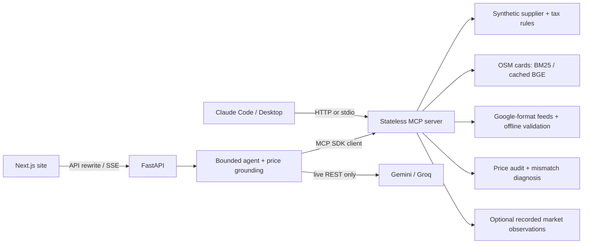

# Rate Truth

An MCP gateway for Dubai hotel shopping and distribution operations. Hotels and
geography come from OpenStreetMap. **Rates and inventory are SYNTHETIC**, computed
by a documented supplier engine. Every quote carries `rate_id`, `computed_at`,
sourced charge rules and an all-in AED total. Holds are mock-only.

The agent uses the real MCP server and checks answer prices against supplier
folios returned during the same turn. Ops tools generate feeds built to Google's
published formats, validate them offline and diagnose deliberately injected
price mismatches. Feeds are never submitted to Google.



## Run locally

Python 3.12+ and Node.js 22 are used in CI. From the repository root:

```sh
python -m venv .venv
# Activate .venv, then:
python -m pip install -r requirements-dev.txt
python -m uvicorn rate_truth.web.app:app --host 127.0.0.1 --port 8170
```

The committed OSM snapshot and XSDs allow offline use. Copy `.env.example` to
`.env` for optional Gemini/Groq credentials; never commit keys. Set
`RATE_TRUTH_LLM_MODE=replay` to force offline chat. On Windows,
`python scripts/dev.py <python arguments>` uses `.venv` and keeps caches in `.local`.

For the site, set `RATE_TRUTH_ORIGIN=http://localhost:3170` in the API process,
then run in `site/`:

```sh
npm ci
npm run dev
```

The site defaults to `http://localhost:3170` and rewrites API requests to
`http://127.0.0.1:8170`. Set `RT_API_URL` before building to change that upstream.
For a public API, configure `RATE_TRUTH_HOSTS` and the exact `RATE_TRUTH_ORIGIN`
(scheme, hostname and port). Set a shared `RATE_TRUTH_SECRET` for mock-hold
capabilities across workers. See [tools and transport](docs/tools.md).

## Connect Claude

For Claude Code, start the API and add its stateless HTTP endpoint:

```sh
claude mcp add --transport http rate-truth http://127.0.0.1:8170/mcp
# Hosted endpoint:
claude mcp add --transport http rate-truth https://YOUR_API_HOST/mcp
```

Claude Desktop can launch the local stdio server. Add this entry to its
`claude_desktop_config.json`, replacing the absolute repository and Python paths:

```json
{
  "mcpServers": {
    "rate-truth": {
      "command": "/absolute/path/rate-truth/.venv/bin/python",
      "args": ["-m", "rate_truth.mcp_server.server"],
      "env": {"PYTHONPATH": "/absolute/path/rate-truth"}
    }
  }
}
```

On Windows use the absolute `.venv\\Scripts\\python.exe` path with JSON-escaped
backslashes. `PYTHONPATH` supplies the repository regardless of Desktop's working
directory. Restart Desktop after editing its configuration. No model key is
needed for external MCP clients to call the local tools.

## Results

These tables are generated by `python scripts/render_readme.py`. Live agent
quality, replay coverage, retrieval and injected-fault detection are separate
measurements. [Evaluation methodology](docs/evaluation.md) documents denominators,
failure reasons, quota pacing, resumption and bounded load workloads.

<!-- BEGIN EVAL RESULTS -->

Measured results from [eval/results.json](eval/results.json). Zero-denominator metrics are not measured.

**Live agent** — model `gemini-3.5-flash-lite`, mode `live`, n=4/55, run `2026-11-12T06:39:36.762745+00:00`; complete: false.

| Metric | Numerator / denominator | Rate |
| --- | ---: | ---: |
| tool selection accuracy | 2 / 4 | 0.5000 |
| refusal clarify correctness | 0 / 0 | not measured |
| diagnosis accuracy | 0 / 0 | not measured |
| argument accuracy | 5 / 9 | 0.5556 |
| grounded price rate | 9 / 9 | 1.0000 |
| task success | 2 / 4 | 0.5000 |

Failing task IDs: s03, s04.

Quota errors (excluded from accuracy): 0; IDs: none.

**Offline replay smoke (not model quality)** — model `recorded-or-scripted-replay`, mode `replay`, n=55/55, run `2026-11-12T06:49:05.689377+00:00`; complete: true.

| Metric | Numerator / denominator | Rate |
| --- | ---: | ---: |
| tool selection accuracy | 18 / 55 | 0.3273 |
| refusal clarify correctness | 5 / 11 | 0.4545 |
| diagnosis accuracy | 0 / 7 | 0.0000 |
| argument accuracy | 18 / 64 | 0.2812 |
| grounded price rate | 15 / 15 | 1.0000 |
| task success | 11 / 55 | 0.2000 |

Failing task IDs: s01, s03, s05, s06, s11, s12, s13, s14, s15, s18, s21, s22, s23, s24, s25, s26, s27, s28, s29, s30, s31, s32, s33, s34, s35, s36, s37, s38, s39, s40, o01, o02, o03, o04, o05, o06, o07, o08, o09, o10, o11, o12, o14, o15.

Quota errors (excluded from accuracy): 0; IDs: none.

**Retrieval** — 30 queries, macro averages.

| Metric | BM25 | Hybrid |
| --- | ---: | ---: |
| hit_at_5 | 0.6333 | 0.8333 |
| precision_at_5 | 0.5133 | 0.6067 |
| r_precision | 0.5391 | 0.4875 |
| ndcg_at_10 | 0.5276 | 0.6609 |

**Injected-fault classifier** — seed 2026; synthetic corruption and clean controls, not production accuracy.

| Fault | Samples | TP / injected | Precision | Recall | Diagnosis |
| --- | ---: | ---: | ---: | ---: | ---: |
| currency_rounding | 30 | 9 / 9 | 1.0000 | 1.0000 | 1.0000 |
| hotel_not_listed | 30 | 9 / 9 | 1.0000 | 1.0000 | 1.0000 |
| los_mismatch | 30 | 8 / 8 | 1.0000 | 1.0000 | 1.0000 |
| missing_discount | 30 | 9 / 9 | 1.0000 | 1.0000 | 1.0000 |
| stale_cache | 30 | 8 / 8 | 1.0000 | 1.0000 | 1.0000 |
| tax_rule_change_missed | 30 | 3 / 3 | 1.0000 | 1.0000 | 1.0000 |
| taxes_fees_omitted | 30 | 8 / 8 | 1.0000 | 1.0000 | 1.0000 |

Rounding of two fils remains inside the advertised matching tolerance.

**Local stateless HTTP load** — 200 calls/tool, concurrency 8, Python 3.14.7; run `2026-11-12T06:15:44.929894+00:00`.

Nearest-rank p50/p95 of complete SDK call_tool round trips, excluding client initialization and queue wait. Warm HTTP connection pool; no warmup calls removed. One-hotel feeds, two-hotel comparison, audit n=10, BM25, cached market only, ADR baseline without market calibration. hold_offer measures confirm=false refusals/throttle; no holds are created. Error latencies are included and error counts are explicit. Local results are not deployment latency or throughput guarantees.

| Tool | p50 ms | p95 ms | Successes / calls | Errors |
| --- | ---: | ---: | ---: | ---: |
| search_hotels | 703.103 | 1168.838 | 200 / 200 | 0 |
| get_rates | 14.472 | 21.449 | 200 / 200 | 0 |
| check_availability | 13.644 | 19.970 | 200 / 200 | 0 |
| recommend_hotels | 38.981 | 58.586 | 200 / 200 | 0 |
| compare_hotels | 15.881 | 23.315 | 200 / 200 | 0 |
| market_check | 11.601 | 112.003 | 200 / 200 | 0 |
| hold_offer | 11.668 | 15.590 | 0 / 200 | 200 |
| build_hotel_list_feed | 29.906 | 36.582 | 200 / 200 | 0 |
| build_ari_messages | 33.360 | 42.742 | 200 / 200 | 0 |
| validate_feed | 21.473 | 28.556 | 200 / 200 | 0 |
| run_price_accuracy_audit | 402.670 | 453.077 | 200 / 200 | 0 |
| explain_mismatch | 375.261 | 420.165 | 200 / 200 | 0 |
| tax_rules_at | 13.805 | 18.940 | 200 / 200 | 0 |

<!-- END EVAL RESULTS -->

## Verify

```sh
python -m ruff check .
python -m pytest -q -p no:cacheprovider --basetemp=.local/pt-m5-local
python scripts/render_readme.py --check
python eval/run_eval.py --mode replay
python eval/load.py
python scripts/render_readme.py
```

From `site/`: `npm run lint`, `npm run typecheck`, `npm test`, `npm run build`,
then `npm run e2e -- --project=desktop --project=phone`. Install Chromium first
with `npx playwright install chromium`. Fixture projects intercept API calls and
require no backend or provider keys. The opt-in live project is excluded from CI.
CI installs pinned Python requirements and npm's lockfile, validates feeds with
the committed schemas, and runs replay without secrets. Network access is only
needed for dependency and browser installation.

Live evaluation is a separate network-enabled command:

```sh
python scripts/dev.py eval/run_eval.py --mode live --run-id gemini-m5-20261112
# Resume after quota resets:
python scripts/dev.py eval/run_eval.py --mode live --resume gemini-m5-20261112
python scripts/dev.py scripts/render_readme.py
```

Build the non-root API image with `docker build -t rate-truth .`, then run
`docker run --rm -p 8170:8000 -e RATE_TRUTH_LLM_MODE=replay rate-truth`.
Runtime configuration and optional keys belong in environment variables, not the
image. Persistent market storage requires an explicitly mounted directory.

## Data sources and licences

- **OpenStreetMap:** © [OpenStreetMap contributors](https://www.openstreetmap.org/copyright),
  under the [Open Database Licence (ODbL)](https://opendatacommons.org/licenses/odbl/).
  `data/osm/` records the Overpass query, source timestamps and hashes. Missing
  stars remain unknown; the separate pricing fallback is explicitly disclosed.
  Distances are straight-line calculations, not walking routes.
- **Google XSDs:** published schemas fetched from `gstatic.com` on **2026-11-11**,
  with exact URLs, fetch time, digests and local import rewrites in
  [cached-sources.json](rate_truth/feeds/xsd/cached-sources.json).
  They are Google-published schema artifacts; no project licence is asserted
  over them. The bundled W3C `xml.xsd` retains its own source notice. ARI uses
  structural checks where no Google XSD is bundled. See [feed validation](docs/google-feeds.md).
- **Taxes and supplier calibration:** [tax_rules.yaml](data/tax_rules.yaml) records
  source URLs, access dates, effective dates and confidence. The
  [supplier model](docs/supplier-model.md) documents the public Dubai DET ADR
  calibration, assumptions and synthetic formula. Secondary-confidence service
  charge and unresolved tax bases are disclosed; remittance relief is not a guest
  fee waiver.
- **Xotelo:** optional third-party booking observations, matched conservatively
  to OSM properties, with provider and fetched time. Provider data is governed by
  its own terms; no ODbL or project licence is asserted over hotel rates, images
  or ratings. Matching publishes identity evidence, without provider images or ratings.
- **SerpApi:** optional Google Hotels observations requiring a key and budget.
  These are third-party observations, not supplier quotes or a Google feed
  integration. Provider terms apply. See [market sources and limits](docs/market.md).

## Honest limits

Synthetic prices and inventory do not establish bookable offers. Market anchors
remain observations with differing rooms, meals, cancellation terms and tax
coverage. Matching can miss properties; unverified multi-night Xotelo semantics
fail closed. Unknown OSM facts and relief eligibility are never inferred as facts.

Retrieval is imperfect; the table includes weak results. BM25 is the fallback
when the optional local BGE model/index is absent or stale. A model answer can
still fail grounding; the failure remains visible. Replay plans and recordings
exercise plumbing and are not evidence of live model task success. Deterministic
refusal scoring can miss paraphrases; inspect individual failure reasons.

Live evaluation adds quota wait allowance to the production agent deadline and
does not measure interactive latency. Local load numbers use bounded requests;
hold timings measure refusals, and full-catalog feed performance is not represented.
Fault metrics concern controlled synthetic corruptions and clean controls, not
accuracy against a live distribution channel.

Holds, throttling, replay protection and local SQLite budgets are per instance.
A shared signing secret does not provide global quotas or durable inventory.
Future tax rules repeat the researched baseline as a synthetic assumption.
No live supplier or Google submission endpoint is connected.

Further details: [architecture](docs/architecture.md), [agent boundaries](docs/agent.md),
[API contract](docs/api-contract.md), [MCP tools](docs/tools.md).
