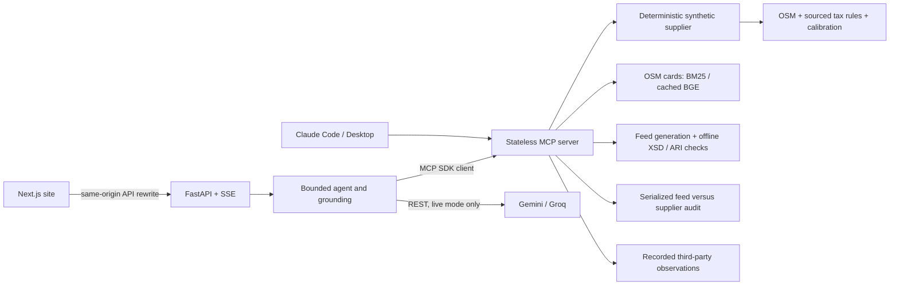

# Architecture

The agent calls the same MCP tools external clients use. Price grounding accepts
only supplier folio totals and charge lines returned during that turn and attaches
their rate IDs. A failed grounding check remains visible; it does not rewrite the
answer into a claimed success. Read [agent.md](agent.md) and
[tools.md](tools.md) for boundaries and transport details.

The Next.js site proxies `/api/*` and `/mcp` to the Python API. The Python ASGI
entrypoint is `rate_truth.web.app:app` (also exposed as root `app.py`). Browser
origin and MCP Host checks are configured explicitly. Instance-local inventory,
throttles, capability replay state and local SQLite budgets are not global quotas.
Shared HMAC secrets verify capabilities across workers but do not make state durable.

Google feeds are generated and checked locally. Hotel List, Property Data and
Transaction formats use cached published schemas; ARI messages use structural
checks. There is no Google submission path. Third-party Google observations, when
enabled through SerpApi, are distinct from this local feed validation.
